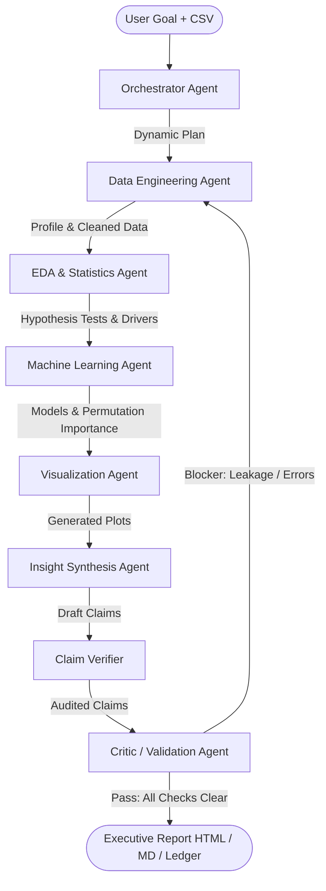

# Autonomous Multi-Agent AI System Architecture

## 1. System Philosophy & Differentiator

Existing LLM data analysis tools suffer from two critical failure modes:
1. **Hallucination of statistical metrics:** LLMs invent plausible-sounding correlations, p-values, or accuracies.
2. **Methodological blind spots:** LLMs fail to check for target leakage, severe class imbalance, or model overfitting.

Our architecture solves this through an absolute invariant:
> **A number may only appear in a report if a deterministic tool computed it and the Evidence Ledger recorded it.**

The LLM agents decide *what* to investigate and coordinate the workflow; Python tools compute the facts; and a verification gate enforces mathematical truth.

---

## 2. Agent Roles and State Management



### The 7 Specialized Agents

1. **Orchestrator Agent (`ads/agents/orchestrator.py`):**
   - Ingests natural language objective and column schemas.
   - Dynamically proposes an ordered task sequence.
   - Falls back gracefully to the deterministic sequence in offline mode.

2. **Data Agent (`ads/agents/data.py`):**
   - Tools: `profile_dataset`, `identify_target`, `clean_data`, `detect_leakage`, `drop_columns`.
   - Profiles missingness, detects IDs, infers prediction targets, cleans data, and strips target leakage columns.

3. **EDA / Statistical Agent (`ads/agents/eda.py`):**
   - Tools: `test_association`, `top_correlations`, `segment_rates`.
   - Runs parametric and non-parametric hypothesis tests with Benjamini-Hochberg False Discovery Rate correction and computes segment rates.

4. **Machine Learning Agent (`ads/agents/ml.py`):**
   - Tools: `train_cv`, `permutation_importance`, `detect_leakage`.
   - Trains models using stratified cross-validation on the train split, evaluates on a held-out test split, compares against majority baselines, and calculates feature importances.

5. **Visualization Agent (`ads/agents/viz.py`):**
   - Tools: `plot_target_by_feature`, `plot_importance`, `plot_correlation`.
   - Generates publication-ready artifacts (correlation matrices, segment outcome bars, importance rankings).

6. **Insight Agent (`ads/agents/insight.py`):**
   - Ingests the Evidence Ledger digest.
   - Generates structured JSON claims `[{"text": "...", "evidence_ids": ["E0001"]}]`.
   - Passes claims through the Claim Verifier rewrite loop.

7. **Critic / Validation Agent (`ads/agents/critic.py`):**
   - Evaluates 7 programmatic checks (Leakage, Implausible Scores, Sample Size, Overfitting Gap, CV Stability, Multiplicity, Causal Language).
   - Generates targeted feedback and computes the 100-point Confidence Rubric score.
   - Triggers targeted backward routing if a blocker is identified.

---

## 3. Append-Only Evidence Ledger (`ads/ledger.py`)

Every tool execution is routed through `execute_tool()`:
- Computes exact numbers in Python (NumPy, SciPy, scikit-learn).
- Creates an immutable `Evidence` record:
  ```python
  Evidence(
      id="E0001",
      tool="profile_dataset",
      args={},
      result={"n_rows": 569, "n_columns": 31, "missing_cells": 0},
      summary="Dataset has 569 rows and 31 columns...",
      dataset_version="v0",
      step=1
  )
  ```
- Cached per dataset version: repeated queries are instant and free.

---

## 4. Claim Verifier Gate (`ads/verify.py`)

Every claim statement is audited against its cited evidence:
1. Cites at least one valid evidence ID.
2. Every number extracted from the claim text must exist within the numeric pool of the cited evidence.
3. If verification fails, the claim is rejected and sent back to the Insight Agent for rewriting. Unresolved claims are banished to the Audit Appendix.

---

## 5. Confidence Rubric

The Critic Agent scores reliability using a documented, additive checklist:

| Check | Weight | Criterion |
| :--- | :---: | :--- |
| `no_leakage` | 25 | Zero target leakage suspects detected |
| `adequate_sample` | 15 | Dataset size $\ge 200$ rows |
| `controlled_overfitting` | 20 | Generalization gap between train and CV $\le 10\%$ |
| `beats_baseline` | 15 | Model performance exceeds majority-class baseline |
| `verified_claims` | 15 | 100% of executive claims verified against evidence |
| `multiplicity_correction` | 10 | Multiple comparison correction (Benjamini-Hochberg) applied |
| **Total** | **100** | **Comprehensive Trustworthiness Score** |

